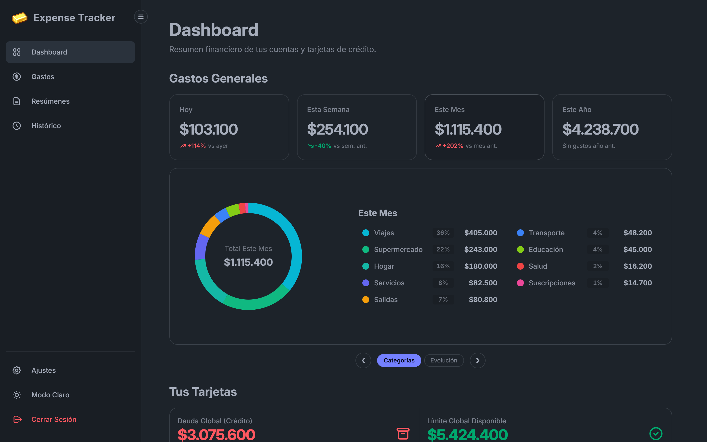
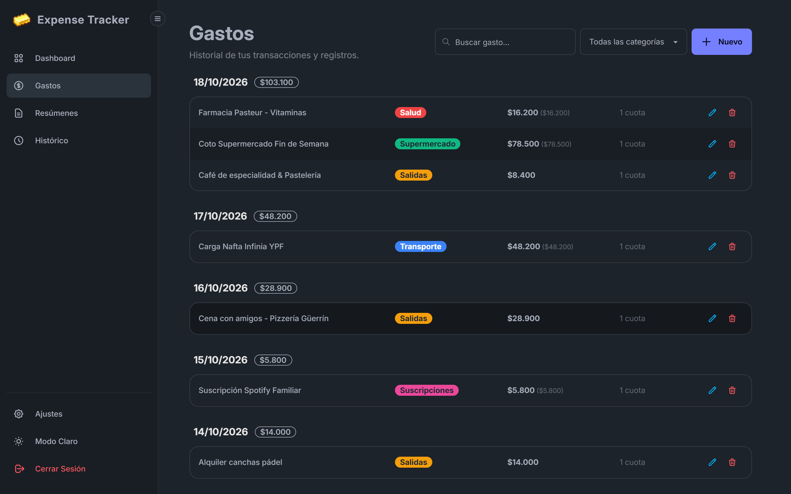
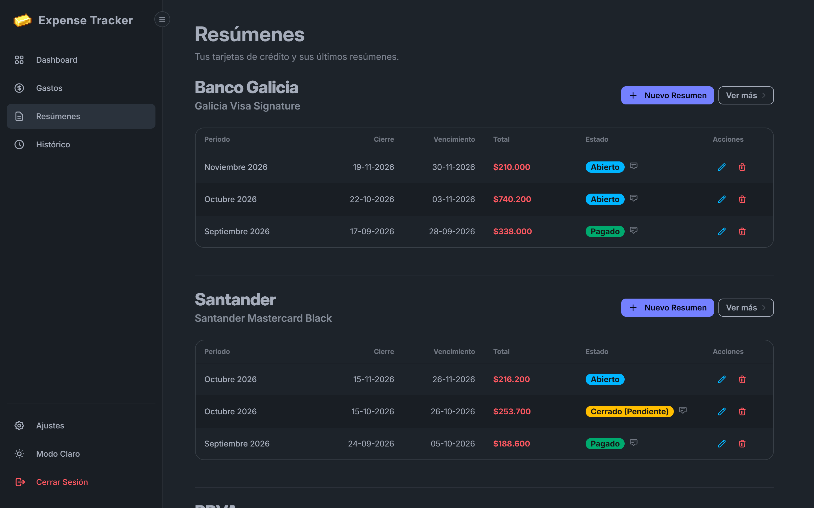
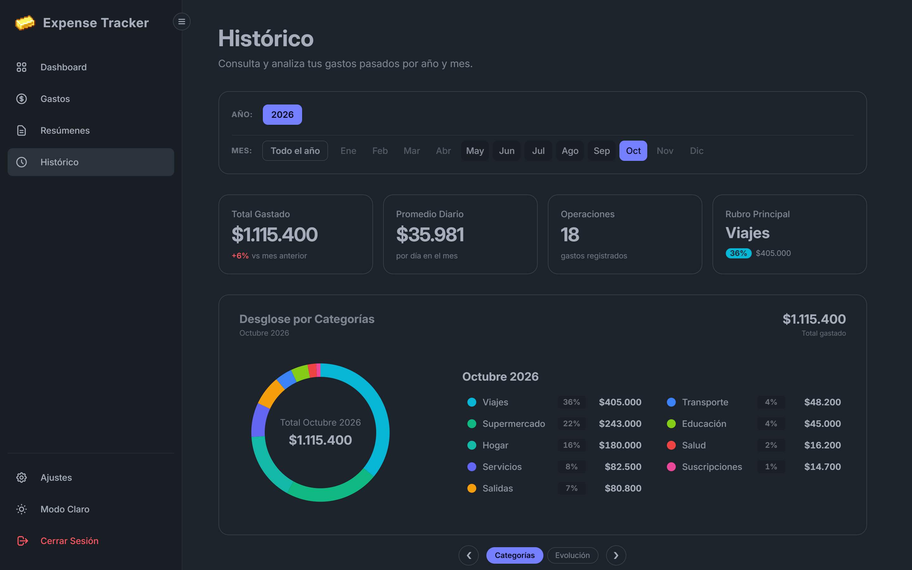

# Expense Tracker — Frontend

Cliente web y de escritorio para **Expense Tracker**, una aplicación orientada al seguimiento de finanzas personales con foco en compras en cuotas, ciclos de tarjetas de crédito y análisis histórico de gastos. Puede ejecutarse tanto en el navegador como en formato de escritorio nativo mediante **Tauri v2**.

<table width="100%">
  <tr>
    <td width="50%" align="center">
      
      <br />
      <sub>Dashboard</sub>
    </td>
    <td width="50%" align="center">
      
      <br />
      <sub>Pantalla de gastos</sub>
    </td>
  </tr>
  <tr>
    <td width="50%" align="center">
      
      <br />
      <sub>Resúmenes</sub>
    </td>
    <td width="50%" align="center">
      
      <br />
      <sub>Histórico</sub>
    </td>
  </tr>
</table>

---

## Features

- **Control de compras en cuotas:** Cálculo automático de cuotas restantes, asignación al resumen bancario correspondiente y estimación de deuda futura.
- **Seguimiento de tarjetas de crédito:** Monitoreo de fechas de cierre y vencimiento, recargos impositivos y estados de cada resumen (Abierto, Cerrado pendiente de pago o Pagado).
- **Métricas comparativas en tiempo real:** Comparación automática de consumos contra el período equivalente anterior (hoy vs. ayer, semana actual vs. anterior, mes actual vs. anterior).
- **Desglose visual por categorías:** Gráficos de dona interactivos con porcentajes y montos por categoría, evitando superposiciones de texto.
- **Histórico temporal:** Navegación por año y mes con promedio diario de gasto, cantidad de transacciones y rubro principal del período.
- **Doble modalidad (Web y Desktop):** Funciona como SPA web tradicional o como ejecutable de escritorio liviano empaquetado con **Tauri v2** (Rust).
- **Barra lateral colapsable:** Menú adaptable con estado guardado en `localStorage`, transiciones suaves y modo drawer para pantallas móviles.
- **Pull-to-refresh:** Soporte para recargar los datos mediante arrastre o de forma silenciosa en segundo plano.
- **Filtros rápidos:** Búsqueda por texto y filtrado inmediato por categoría en la lista de transacciones.

---

## Tech Stack

- **Framework:** Angular (Standalone Components, Signals, Router con Hash Location)
- **Estilos:** Tailwind CSS + DaisyUI
- **Desktop Wrapper:** Tauri v2 (Rust + WebView2)
- **Testing:** Vitest + JSDOM
- **Backend asociado:** FastAPI (Python) + SQLModel + SQLite (modo WAL)

---

## Cómo usar o correr el proyecto

### Uso directo

- **Navegador:** Accedé a la aplicación en [expenses.tomasd.com.ar](https://expenses.tomasd.com.ar).
- **Escritorio:** Descargá los ejecutables o instaladores para tu sistema operativo (`.msi`, `.exe`) directamente desde [GitHub Releases](https://github.com/tdominguez33/expense-tracker-frontend/releases).

---

### Desarrollo local (código fuente)

#### Prerrequisitos

- Node.js (v20 o superior recomendado)
- Backend de Expense Tracker corriendo (por defecto en `http://127.0.0.1:8000`)
- Rust y herramientas de build (solo requerido si se va a compilar o correr con Tauri)

### Instalación

```bash
npm install
```

### Desarrollo

#### 1. Modo Web (Navegador)
Inicia el servidor local de Angular en `http://localhost:4200`:
```bash
npm start
```

#### 2. Modo Desktop (Tauri)
Levanta la ventana de escritorio con recarga en vivo:
```bash
npm run tauri:dev
```

### Compilación para Producción

#### Build Web
Genera los archivos estáticos optimizados en `dist/`:
```bash
npm run build
```

#### Build Desktop
Genera los instaladores nativos para el sistema operativo actual (`.exe` / `.msi` en Windows):
```bash
npm run tauri:build
```

---

## Tests

El frontend cuenta con tests unitarios implementados con **Vitest**:

```bash
# Correr tests una sola vez
npm test -- --watch=false

# Correr tests en modo observador
npm test
```